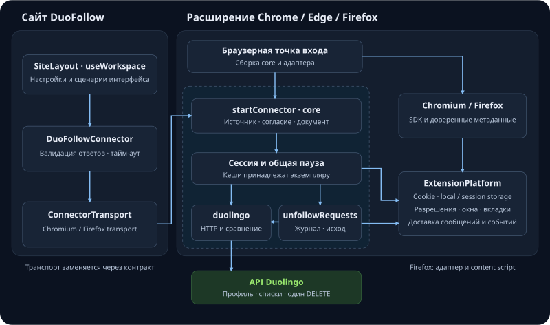
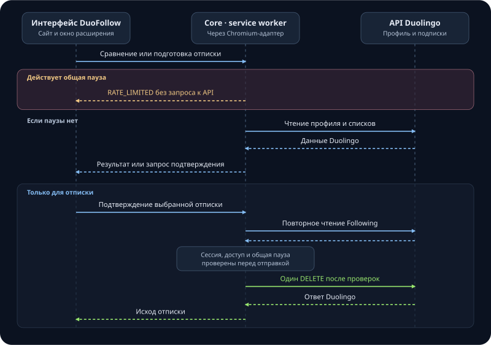

# Архитектура DuoFollow

## Карта зависимостей

[`SiteLayout`](../../src/SiteLayout.tsx) держит настройки сайта и рабочее состояние через `useWorkspace`.
React Router передаёт это состояние маршрутам через `Outlet`. Главная отображает его в `Workspace`.
Виртуальный список отдельно управляет видимыми строками и прокруткой.

[`useWorkspace`](../../src/following/useWorkspace.ts) связывает проверку подключения, сравнение, отписку и уведомления.
Эти сценарии обращаются к [`DuoFollowConnector`](../../src/api/extension/DuoFollowConnector.ts), который отправляет
команды через заменяемый `ConnectorTransport` и проверяет ответы. Chromium-транспорт доставляет их через Runtime.
[`background.ts`](../../extension/src/background.ts) выбирает Chromium-адаптер и запускает
[`core/createConnector.ts`](../../extension/src/core/createConnector.ts). Core проверяет источник команды и выданный доступ.
[`core/duolingo.ts`](../../extension/src/core/duolingo.ts) выполняет команды к Duolingo,
а [`core/unfollowRequests.ts`](../../extension/src/core/unfollowRequests.ts) управляет подготовкой,
подтверждением и восстановлением исхода отписки. Cookie, хранение, разрешения и окна доступны через `ExtensionPlatform`.

## Последовательность сетевых операций

Проверка сессии, сравнение и отписка используют один срок паузы после HTTP 429. Сравнение читает профиль,
Following и Followers. Подготовка отписки читает профиль и Following, затем открывает окно расширения
или возвращает идентификатор операции для подтверждения на сайте. Пауза проверяется повторно
непосредственно перед `DELETE`.

При потере ответа на `DELETE` worker сверяет Following в той же сессии. Если результат неизвестен
или пауза блокирует проверку, карточка остаётся в списке. Для новой попытки нужно новое подтверждение.
Детали команд и ответов приведены в [руководстве Connector](connector.md).

## Декомпозиция

Тестовый образ содержит зависимости и готовые сборки сайта и расширения. Во время прогона Compose
монтирует результаты и эталоны. Контейнерный запуск записывает отдельный отчёт ресурсов и сохраняет статус Playwright.
Эта инфраструктура не входит в браузерный bundle приложения.
[Ресурсы тестового окружения](release.md#ресурсы-контейнера-и-сравнение-прогонов)

`Tooltip` объединяет позиционирование и жизненный цикл подсказок, сохраняет исходный элемент и выводит подсказку
через портал. `TooltipProvider` в общем макете хранит настройку показа и координирует владельца подсказки.
При переходе между элементами предыдущий портал удаляется сразу, а новая подсказка не повторяет анимацию появления.
Перемещение указателя не обновляет контекст и не перерисовывает весь список. Подсказки пропускают указатель.
`useAppearance` сохраняет настройку `tooltips` вместе с размером текста, шрифтом и режимом различения статусов.
`useFollowingPanelHeight` управляет доступной высотой списка и скелета через ResizeObserver.
Эти модули относятся к интерфейсу и не обращаются к Connector.
[ADR-0013](../decisions/records/0013-workspace-scroll-and-tooltips.md)
[ADR-0014](../decisions/records/0014-tooltip-preferences-and-lifecycle.md)

Ревизия от 22 ноября 2026 года определяет следующие границы для переноса расширения и разделения стилей:
[общая логика и визуальный слой](browser-architecture-review.md). Внутренний core и общий Chromium-адаптер выделены.
Их [контракты и проверки](browser-adapter-contracts.md) определяют границы следующей итерации Firefox.
Самостоятельный пакет оценивается при появлении независимого потребителя.
Стили сайта разделяются перед реализацией нового оформления.

Текущие границы проходят между интерфейсом, хуками сценариев, клиентом сообщений и worker. Состояние сравнения
живёт в общем макете, а позиция прокрутки и видимые строки принадлежат виртуальному списку. Отдельное
глобальное хранилище для одной рабочей области не требуется.

`core/duolingo.ts` выполняет сетевые вызовы и собирает сравнение. `duolingoPayload.ts` разбирает профиль и страницы
отношений из неизвестных данных. Один парсер Followers используется при проверке сессии и при сравнении.
Запросы, пауза и права доступа остаются у сетевого слоя и worker. Дальнейшее выделение модулей оправдано,
когда у сценария появляется самостоятельная модель данных или отдельный набор правил и тестов.

`Workspace` показывает карточку активного аккаунта или форму ручного сравнения, статистику и область списка.
`core/duolingoSession.ts` отвечает за проверку сессии и краткосрочный кеш подтверждённого профиля внутри экземпляра core.
`useWorkspace` запускает сравнение при первом обнаружении профиля и очищает данные при смене подтверждённого аккаунта. Выделение секции оправдано, когда она
получает самостоятельные правила отображения, повторно используется или требует отдельного тестирования.
Локальный reducer уместен при появлении нескольких зависимых переходов состояния с одинаковыми правилами
сброса. Общее хранилище стоит пересмотреть при появлении второго независимого потребителя результата
или требования синхронизации вкладок.

Сценарии worker проверяются через Chromium-вход и через контракт платформы без глобального SDK.
AST-проверки не допускают браузерные реализации в зависимостях core. Разделение
`background.test.ts` по проверке сессии, сравнению и отписке уместно, когда новые сценарии начинают
использовать разные настройки фикстуры. Общий запуск worker и имитация хранилища остаются в одной фикстуре.

[К руководству разработчика](development-guidelines.md)
